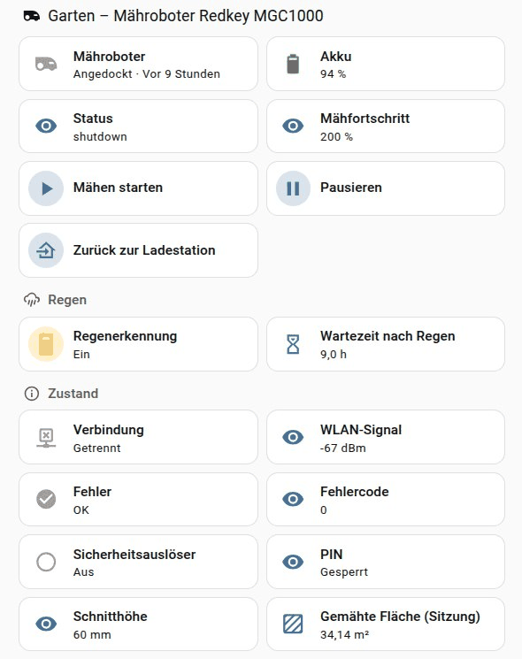

<p align="center">
  
  &nbsp;&nbsp;
  
</p>

<h1 align="center">MGC Mower for Home Assistant</h1>

<p align="center">
  <a href="https://hacs.xyz"></a>
  <a href="https://github.com/dktzde/ha-mgc-mower/actions/workflows/hassfest.yml"></a>
  <a href="https://github.com/dktzde/ha-mgc-mower/actions/workflows/hacs.yml"></a>
  <a href="https://github.com/dktzde/ha-mgc-mower/releases"></a>
  <a href="LICENSE"></a>
  <a href="https://github.com/dktzde/ha-mgc-mower/stargazers"></a>
</p>

<p align="center">
  Control and watch your <b>MGC robotic lawn mower</b> in Home Assistant:<br>
  <b>Redkey MGC1000 / MGC500, Handwise MGC500 (MGC01 500), Redroad MGC500, Anthbot Pion</b> and possibly EZVIZ RM600.<br>
  Developed and maintained by <a href="https://github.com/dktzde">dktzde</a>.
</p>

<p align="center">
  ⭐ <b>If you find this integration useful, please star the repository!</b> ⭐<br>
  Something doesn't work, or your model is missing? <a href="https://github.com/dktzde/ha-mgc-mower/issues/new/choose">Please open an issue</a>.
</p>

<p align="center">
  <a href="#english">English</a> · <a href="#français">Français</a> · <a href="#deutsch">Deutsch</a>
</p>

---

# English

## Why install it?

- **Your mower in Home Assistant:** state, battery, progress, errors and Wi-Fi next to the rest of your home, with history and automations.
- **Rain settings that work on MGC mowers:** switch rain detection on or off and set the wait time after rain from **0 to 12 hours in 0.1 h steps**. The app only offers 1–3 h.
- **Weekly mowing schedule from Home Assistant:** days, start and end time, cutting height and mowing direction with one action. The schedule is stored in the mower and runs without Home Assistant.
- **Knows when the mower is really offline:** the cloud keeps saying "online" after the mower lost power; this integration asks the mower and shows the real connection.
- **Event codes in plain text:** the codes from the app's Message Center are shown with the app's text.
- **English, French and German**, an example dashboard and no extra hardware: you only need the app account.

## Screenshot

<p align="center">
  <br>
  <sub>Dashboard with the entities of this integration (Home Assistant set to German)</sub>
</p>

## Features

| Type | Entities |
|---|---|
| Lawn mower | start, pause, return to dock |
| Buttons | Start mowing · Pause mowing · Return to dock |
| Switch | Rain detection |
| Numbers | Mow height (30–70 mm) · Rain wait time (0–12 h) |
| Binary sensors | Connection · Charging · Rain detection · Error · Safety trigger |
| Sensors | Mower status · Battery level · Mowing progress · Mowing area · Cutting height · Mowing schedule · Rain wait time · Rain effect · Error code · Event code · PIN status · Mode · WiFi signal · IP address · Current mow passes · firmware of four boards · map and path data |

**Actions:** `set_mowing_schedule`, `start_full_mow`, `start_zone_mow`, `start_auto_zone_mow`, `stop_mow`, `return_to_dock`, `set_mow_height`, `set_custom_mowing_direction`, `set_voice_volume` (all in the `mgc_mower` domain).

```yaml
action: mgc_mower.set_mowing_schedule
target:
  entity_id: lawn_mower.your_mower
data:
  entries:
    - weekdays: [mon, wed, fri]
      start: "17:00"
      end: "19:00"        # optional, empty = until finished
      cutter_height: 55   # 30–70 mm
      direction: cross    # perpendicular | parallel | cross
```

The app always sends the complete schedule, so a change in the app overwrites the one from Home Assistant and vice versa.

**Example dashboard:** control, rain settings and a weekly schedule editor in English, French and German, see [extras/dashboard](extras/dashboard/).

**Event codes:** what the values of the `Event code` sensor mean, and how to read your own, see [extras/event_codes](extras/event_codes/).

**Unknown event codes – please help:** when your mower reports a code the integration does not know yet, Home Assistant shows a notification (once per code). It links to a pre-filled issue: just add a screenshot of the app message, or copy its text. You can turn this off in the integration options (*Settings → Devices & services → MGC Mower → Configure*); it is on by default. The link contains no serial number, IP address or account data.

## Installation

**HACS (recommended):**

[](https://my.home-assistant.io/redirect/hacs_repository/?owner=dktzde&repository=ha-mgc-mower&category=integration)

1. Click the button above, or in HACS → ⋮ → *Custom repositories* add `https://github.com/dktzde/ha-mgc-mower` with the type *Integration*.
2. Download *MGC Mower*. The newest versions are pre-releases: to get them, switch on *Show beta versions* for this repository.
3. Restart Home Assistant.

**Manual:** copy `custom_components/mgc_mower` from the [latest release](https://github.com/dktzde/ha-mgc-mower/releases) to `config/custom_components/mgc_mower` and restart Home Assistant.

**Set up:**

[](https://my.home-assistant.io/redirect/config_flow_start/?domain=mgc_mower)

Or *Settings → Devices & services → Add integration → MGC Mower*, then sign in with your app account (Redkey: R HOME account, API host `api.anthbot.com`).

> Coming from Handwise-HA? Remove it first, otherwise the mower shows up twice.

## Models

| Model | Status |
|---|---|
| Redkey MGC1000 | ✅ tested by me |
| Handwise MGC500 (MGC01 500) | ✅ tested (original project) |
| Redkey MGC500, Redroad MGC500, Anthbot Pion | ❔ largely identical hardware, should work |
| EZVIZ RM600 | ⚠️ largely identical hardware, but may use a different cloud |

Is your model missing or does it behave differently? Please [open an issue](https://github.com/dktzde/ha-mgc-mower/issues/new/choose).

## Support this project

- ⭐ **Star the repository** if the integration is useful to you – it shows me that the work is worth it.
- 🐞 **Open an issue** for bugs, questions, unknown event codes or feedback on your model.
- 🔧 Pull requests are welcome.

> 🌱 **Hobby project:** I maintain this in my spare time and answer at my own pace. No guarantee and no promise of lifelong maintenance.

> ❄️ My mower is in winter hibernation; the newest changes have only been tested briefly.

History and thanks: see [the end of this page](#history-and-thanks).

---

# Français

## Pourquoi l'installer ?

- **Votre tondeuse dans Home Assistant :** état, batterie, progression, erreurs et Wi-Fi à côté du reste de la maison, avec historique et automatisations.
- **Réglages de pluie qui fonctionnent sur les tondeuses MGC :** activer ou désactiver la détection de pluie et régler l'attente après la pluie de **0 à 12 heures par pas de 0,1 h**. L'application ne propose que 1–3 h.
- **Planning de tonte hebdomadaire depuis Home Assistant :** jours, heure de début et de fin, hauteur de coupe et sens de tonte en une seule action. Le planning est enregistré dans la tondeuse et fonctionne sans Home Assistant.
- **Sait quand la tondeuse est vraiment hors ligne :** le cloud indique encore « en ligne » quand la tondeuse n'a plus de courant ; l'intégration interroge la tondeuse et affiche la vraie connexion.
- **Codes d'événement en clair :** les codes du centre de messages de l'application sont affichés avec le texte de l'application.
- **Français, anglais et allemand**, un tableau de bord d'exemple et aucun matériel supplémentaire : il suffit du compte de l'application.

## Capture d'écran

<p align="center">
  <br>
  <sub>Tableau de bord avec les entités de cette intégration (Home Assistant en allemand)</sub>
</p>

## Fonctions

Tondeuse (démarrer, pause, retour à la base), boutons, détection de pluie, hauteur de coupe (30–70 mm), attente après la pluie (0–12 h), connexion, charge, erreur, déclencheur de sécurité, batterie, progression, surface tondue, planning de tonte, code d'erreur, code d'événement, état du code PIN, signal Wi-Fi, firmware et plus. Liste complète et exemple du planning : voir [English](#features).

**Tableau de bord d'exemple :** commande, réglages pluie et planning hebdomadaire en français, anglais et allemand, voir [extras/dashboard](extras/dashboard/).

**Codes d'événement inconnus – aidez-nous :** quand votre tondeuse signale un code que l'intégration ne connaît pas encore, Home Assistant affiche une notification (une fois par code). Elle renvoie vers un ticket pré-rempli : ajoutez simplement une capture d'écran du message de l'app, ou recopiez son texte. Désactivable dans les options de l'intégration (*Paramètres → Appareils et services → MGC Mower → Configurer*) ; activé par défaut. Le lien ne contient ni numéro de série, ni adresse IP, ni données de compte.

## Installation

**HACS (recommandé) :**

[](https://my.home-assistant.io/redirect/hacs_repository/?owner=dktzde&repository=ha-mgc-mower&category=integration)

1. Cliquez sur le bouton ci-dessus, ou dans HACS → ⋮ → *Dépôts personnalisés* ajoutez `https://github.com/dktzde/ha-mgc-mower` avec le type *Intégration*.
2. Téléchargez *MGC Mower*. Les versions les plus récentes sont des pré-versions : pour les obtenir, activez *Afficher les versions bêta* pour ce dépôt.
3. Redémarrez Home Assistant.

**Manuelle :** copiez `custom_components/mgc_mower` de la [dernière version](https://github.com/dktzde/ha-mgc-mower/releases) dans `config/custom_components/mgc_mower` et redémarrez Home Assistant.

**Configuration :**

[](https://my.home-assistant.io/redirect/config_flow_start/?domain=mgc_mower)

Ou *Paramètres → Appareils et services → Ajouter une intégration → MGC Mower*, puis connectez-vous avec le compte de l'application (Redkey : compte R HOME, hôte API `api.anthbot.com`).

> Vous utilisiez Handwise-HA ? Supprimez-la d'abord, sinon la tondeuse apparaît deux fois.

## Modèles

| Modèle | Statut |
|---|---|
| Redkey MGC1000 | ✅ testé par moi |
| Handwise MGC500 (MGC01 500) | ✅ testé (projet d'origine) |
| Redkey MGC500, Redroad MGC500, Anthbot Pion | ❔ matériel très similaire, devrait fonctionner |
| EZVIZ RM600 | ⚠️ matériel très similaire, mais utilise peut-être un autre cloud |

## Soutenir le projet

- ⭐ **Mettez une étoile au dépôt** si l'intégration vous est utile.
- 🐞 **Ouvrez une [issue](https://github.com/dktzde/ha-mgc-mower/issues/new/choose)** pour un bug, une question, un code d'événement inconnu ou un retour sur votre modèle.
- 🔧 Les pull requests sont les bienvenues.

> 🌱 **Projet de loisir :** je le maintiens sur mon temps libre et réponds à mon rythme. Aucune garantie.

Historique et remerciements : voir [la fin de cette page](#history-and-thanks).

---

# Deutsch

## Warum installieren?

- **Dein Mäher in Home Assistant:** Zustand, Akku, Fortschritt, Fehler und WLAN neben dem Rest deines Zuhauses, mit Verlauf und Automationen.
- **Regen-Einstellungen, die bei MGC-Mähern funktionieren:** Regenerkennung ein- und ausschalten und die Wartezeit nach Regen von **0 bis 12 Stunden in 0,1-h-Schritten** einstellen. Die App bietet nur 1–3 h.
- **Wochen-Mähplan aus Home Assistant:** Tage, Start- und Endzeit, Schnitthöhe und Mährichtung mit einer Aktion. Der Plan wird im Mäher gespeichert und läuft auch ohne Home Assistant.
- **Erkennt, wann der Mäher wirklich offline ist:** Die Cloud meldet weiter „online“, wenn der Mäher keinen Strom mehr hat; die Integration fragt beim Mäher nach und zeigt die echte Verbindung.
- **Ereigniscodes im Klartext:** Die Codes aus dem Message Center der App werden mit dem App-Text angezeigt.
- **Deutsch, Englisch und Französisch**, ein Beispiel-Dashboard und keine zusätzliche Hardware: Du brauchst nur das App-Konto.

## Screenshot

<p align="center">
  <br>
  <sub>Dashboard mit den Entitäten dieser Integration</sub>
</p>

## Funktionen

Mäher (Starten, Pause, Zurück zur Station), Tasten, Regenerkennung, Schnitthöhe (30–70 mm), Regen-Wartezeit (0–12 h), Verbindung, Ladevorgang, Fehler, Sicherheitsauslöser, Akkustand, Mähfortschritt, Mähfläche, Mähplan, Fehlercode, Ereigniscode, PIN-Status, WLAN-Signal, Firmware und mehr. Vollständige Liste und Beispiel für den Mähplan: siehe [English](#features).

**Beispiel-Dashboard:** Steuerung, Regen-Einstellungen und Wochen-Mähplan auf Deutsch, Englisch und Französisch, siehe [extras/dashboard](extras/dashboard/).

**Unbekannte Ereigniscodes – bitte mithelfen:** Meldet dein Mäher einen Code, den die Integration noch nicht kennt, zeigt Home Assistant eine Benachrichtigung (einmal je Code). Sie verlinkt ein vorausgefülltes Issue: nur noch einen Screenshot der App-Meldung anhängen oder ihren Text abschreiben. Abschaltbar in den Optionen der Integration (*Einstellungen → Geräte & Dienste → MGC Mower → Konfigurieren*), standardmäßig an. Der Link enthält keine Seriennummer, IP-Adresse oder Kontodaten.

## Installation

**HACS (empfohlen):**

[](https://my.home-assistant.io/redirect/hacs_repository/?owner=dktzde&repository=ha-mgc-mower&category=integration)

1. Auf den Knopf oben klicken oder in HACS → ⋮ → *Benutzerdefinierte Repositories* `https://github.com/dktzde/ha-mgc-mower` mit dem Typ *Integration* hinzufügen.
2. *MGC Mower* herunterladen. Die neuesten Versionen sind Vorabversionen: Dafür bei diesem Repository *Beta-Versionen anzeigen* einschalten.
3. Home Assistant neu starten.

**Manuell:** `custom_components/mgc_mower` aus der [neuesten Version](https://github.com/dktzde/ha-mgc-mower/releases) nach `config/custom_components/mgc_mower` kopieren und Home Assistant neu starten.

**Einrichten:**

[](https://my.home-assistant.io/redirect/config_flow_start/?domain=mgc_mower)

Oder *Einstellungen → Geräte & Dienste → Integration hinzufügen → MGC Mower* und mit dem App-Konto anmelden (Redkey: R-HOME-Konto, API-Host `api.anthbot.com`).

> Du nutzt bisher Handwise-HA? Entferne es vorher, sonst erscheint der Mäher doppelt.

## Modelle

| Modell | Status |
|---|---|
| Redkey MGC1000 | ✅ von mir getestet |
| Handwise MGC500 (MGC01 500) | ✅ getestet (Ursprungsprojekt) |
| Redkey MGC500, Redroad MGC500, Anthbot Pion | ❔ weitgehend baugleich, sollte funktionieren |
| EZVIZ RM600 | ⚠️ weitgehend baugleich, nutzt aber eventuell eine andere Cloud |

## Projekt unterstützen

- ⭐ **Gib dem Repository einen Stern**, wenn dir die Integration nützt.
- 🐞 **Öffne ein [Issue](https://github.com/dktzde/ha-mgc-mower/issues/new/choose)** bei Fehlern, Fragen, unbekannten Ereigniscodes oder Rückmeldungen zu deinem Modell.
- 🔧 Pull Requests sind willkommen.

> 🌱 **Hobbyprojekt:** Ich pflege das in meiner Freizeit und antworte in meinem eigenen Tempo. Keine Garantie.

Historie und Dank: siehe [Ende dieser Seite](#history-and-thanks).

---

## History and thanks

| When | Who | What |
|---|---|---|
| 2026-06-06 – 06-09 | [MTTPoll](https://github.com/MTTPoll) | Created [Handwise-HA](https://github.com/MTTPoll/handwise-ha) for Handwise mowers on the Handwise / Anthbot cloud (0.1.0 on 2026-06-07). |
| from 2026-10-02 | [dktzde](https://github.com/dktzde) | Forked it for a Redkey MGC1000: fixed the rain commands on MGC firmware (2026-10-02) and added the weekly mowing schedule (2026-10-04). |
| 2026-10-14 | dktzde | **0.2.0:** renamed to MGC Mower (domain `mgc_mower`), new README, changelog and license. |
| 2026-10-28 | dktzde | **0.2.1:** example dashboard with weekly schedule editor, issue templates. |
| 2026-11-14 | dktzde | **0.2.2:** real connection state when the mower is off. **0.3.0:** event code texts, notification for unknown codes, English and French translations. |
| 2026-11-20 | dktzde | **0.3.1:** mowing progress capped at 100 %. |

Details: [CHANGELOG](CHANGELOG.md).

**Thank you, [MTTPoll](https://github.com/MTTPoll)!** Your [Handwise-HA](https://github.com/MTTPoll/handwise-ha) did the hard part – the cloud login and the AWS IoT connection – and made this integration possible.
*Merci beaucoup ! · Vielen Dank!*

Unofficial project, not affiliated with Redkey, Handwise, Anthbot, Redroad or EZVIZ. MIT license, see [LICENSE](LICENSE).

---

*Ich besitze einen Redkey MGC 1000. Diese Integration ist mit Hilfe von [Claude](https://github.com/dktzde/hass-claude-code) entstanden.*
